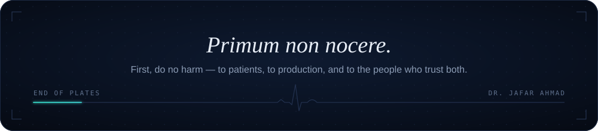

<!--
  Profile README for github.com/Dr2b — lives in the public repository Dr2b/Dr2b.
  Design system, tokens and rationale: docs/UI/github-profile-design.md
  All artwork is local (assets/github-profile/). No external services.
-->

  

  <a href="#case-note">Case&nbsp;note</a> &nbsp;·&nbsp;
  <a href="#defense-in-depth">Defense&nbsp;in&nbsp;depth</a> &nbsp;·&nbsp;
  <a href="#practice">Practice</a> &nbsp;·&nbsp;
  <a href="#case-files">Case&nbsp;files</a> &nbsp;·&nbsp;
  <a href="#consult">Consult</a> &nbsp;·&nbsp;
  <a href="#immune-patrol">Immune&nbsp;patrol</a>

## Case note

Written the way I was trained to write one — SOAP.

<table>
  <tr>
    <td width="96" valign="top"><b>S</b> subjective</td>
    <td valign="top">I was trained to treat the body as a system of systems. I bring the same discipline to software: take a careful history, question the obvious explanation, and never treat what hasn't been diagnosed.</td>
  </tr>
  <tr>
    <td width="96" valign="top"><b>O</b> objective</td>
    <td valign="top">Physician. Full-stack software engineer, from the interface down to the data layer. Blue-team security practitioner — detection, response, hardening. IQ 145.</td>
  </tr>
  <tr>
    <td width="96" valign="top"><b>A</b> assessment</td>
    <td valign="top">Three disciplines, one method. An unwell patient, a failing service and a suspicious login reward the same habits: structured observation, a ranked differential, and evidence before intervention.</td>
  </tr>
  <tr>
    <td width="96" valign="top"><b>P</b> plan</td>
    <td valign="top">Build systems that are correct before they are clever, defended before they are exposed, and humane to the people who depend on them.</td>
  </tr>
</table>

## Defense in depth

No single barrier holds — not skin, not a firewall. Every defence worth trusting, biological or digital, is layered, observable, and learns from whatever got through.

  

## Practice

<table>
  <tr>
    <td width="33%" valign="top">
       
      <b>Medicine</b> 
      the diagnostic method

- Clinical reasoning and differential diagnosis
- Evidence appraisal: what the data actually supports
- Patient safety: failure modes, checklists, handover
- A common language between clinicians and engineers

</td>
    <td width="33%" valign="top">
       
      <b>Engineering</b> 
      full-stack, interface to data

- End-to-end delivery: interface, API, data
- System design with explicit trust boundaries
- Readable, testable code over clever code
- Building what I can also operate

</td>
    <td width="33%" valign="top">
       
      <b>Security</b> 
      blue team

- Monitoring, detection and alert triage
- Incident response: contain, eradicate, recover
- Hardening and attack-surface reduction
- Threat modelling and log analysis

</td>
  </tr>
</table>

<!--
  STACK — list only the tools you actually use. Plain <code> chips keep the page
  dependency-free and on-palette. Uncomment and edit:

  <code>Language</code>&nbsp; <code>Framework</code>&nbsp; <code>Database</code>&nbsp; <code>SIEM</code>&nbsp; <code>Cloud</code>

-->

## Case files

> **In preparation.** Selected work is being written up the way a case is presented — *presenting problem → intervention → outcome* — with the repository attached.

<!--
  CASE FILE TEMPLATE — duplicate one block per project.

<table>
  <tr>
    <td>
      <b><a href="https://github.com/Dr2b/REPOSITORY">Project name</a></b> &nbsp;stack · stack · stack  
      <b>Presenting problem</b> — who was affected and how. 
      <b>Intervention</b> — what you built, and the key technical decision. 
      <b>Outcome</b> — what changed; only results you can verify.
    </td>
  </tr>
</table>
-->

## Consult

Interested in work where medicine, software and security overlap.

  <a href="https://github.com/Dr2b"><b>github.com/Dr2b</b></a>
  <!-- Add only channels you want public:
  &nbsp;·&nbsp; <a href="mailto:you@example.com">Email</a>
  &nbsp;·&nbsp; <a href="https://www.linkedin.com/in/YOUR-ID">LinkedIn</a>
  &nbsp;·&nbsp; <a href="https://your-site.example">Website</a>
  -->

## Immune patrol

Every square is one day of my GitHub activity, read as living tissue. Each morning a new outbreak is seeded into it: antigens appear and spread to neighbouring days, and a phagocyte hunts every one down until the tissue reads *all clear*. It is regenerated daily by a GitHub Action, so no two days play the same.

  

 

  

